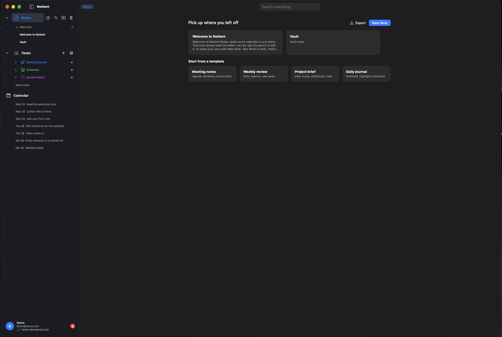
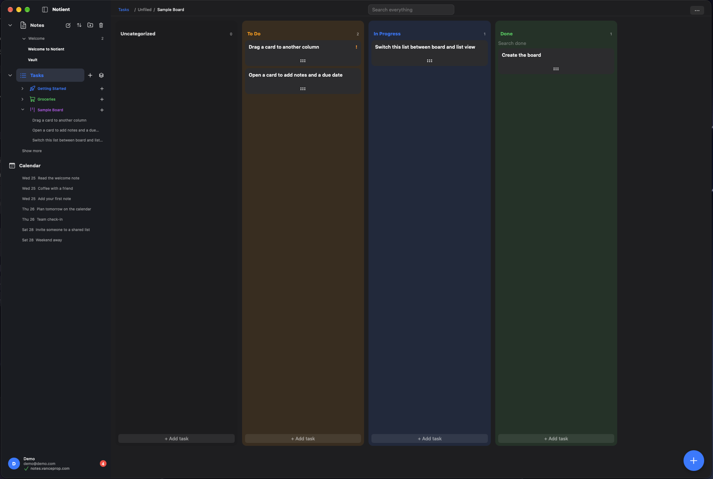
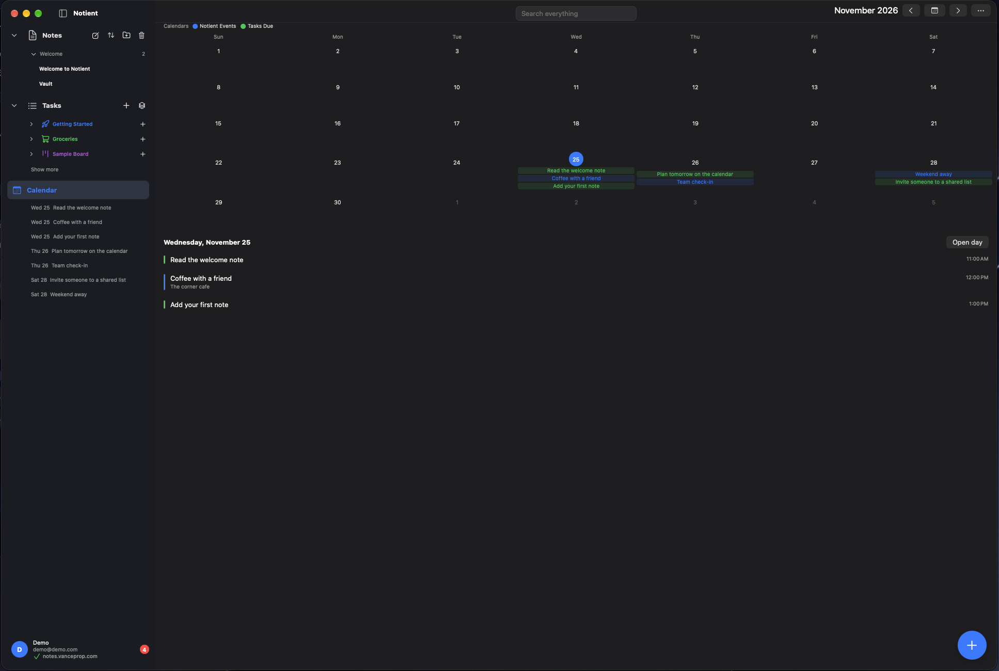
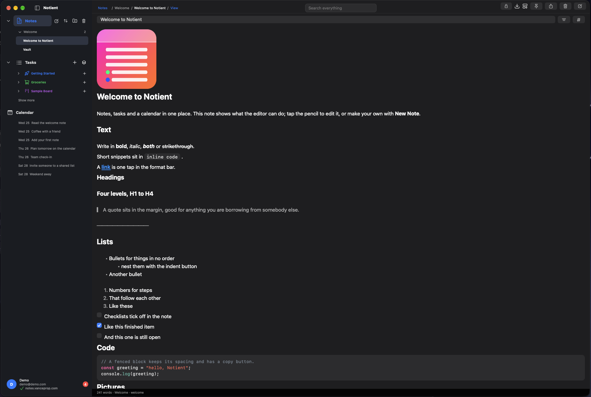
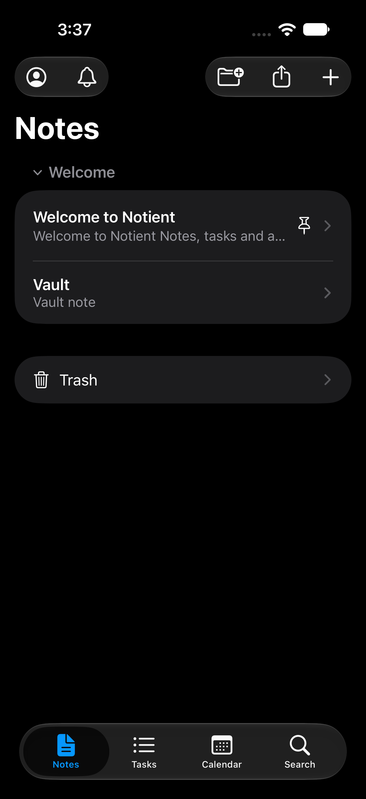
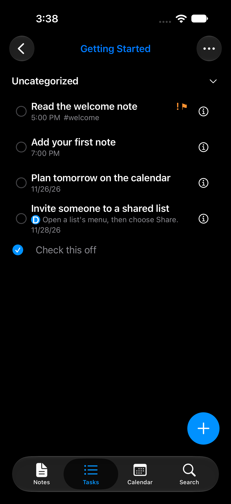
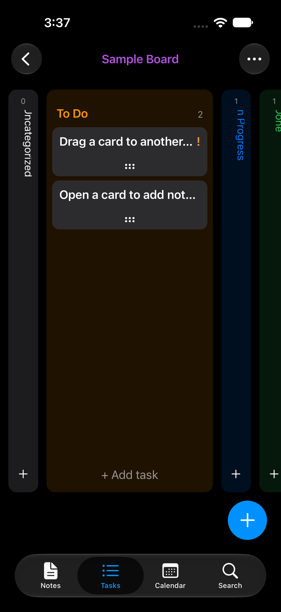
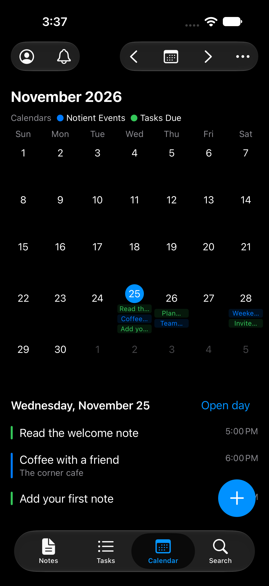
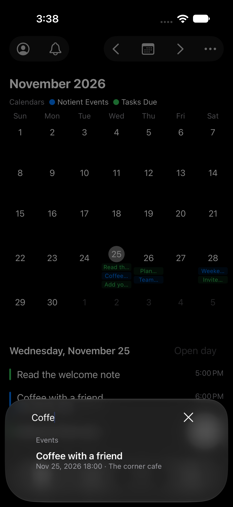
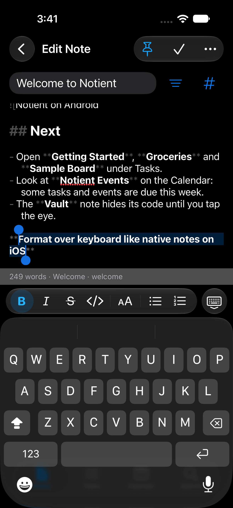

# Notient

An Apple-inspired notes, tasks and calendar suite that runs anywhere and is fast everywhere. Opinionated native UI, one codebase, self-hostable. Built on [Exact](https://github.com/expo/exact).

- **Native, not wrapped.** One contract file draws the same app as a web PWA, a native iOS app and a native macOS app. Lists, sheets, pickers and keyboards are the platform's own.
- **Fast.** Local-first reads, an offline cache, live updates over a WebSocket. Nothing waits on a spinner you could have avoided.
- **Yours.** The server is a small Express and SQLite process you run yourself. Notes are plain Markdown files on disk.

## Screenshots

**macOS**

| | |
| --- | --- |
|  |  |
|  |  |

**iPhone**

| | | |
| --- | --- | --- |
|  |  |  |
|  |  |  |

## What's in it

**Notes**
- Markdown that reads like a document: syntax hides away from the caret, with a format bar (H1 to H4, lists, tasks, quotes, code, links, linked images, dividers).
- Folders, tags, pins, search. Vault notes keep code blocks hidden until you reveal them.
- Images inline, with a scrolling row for runs of images and a full-screen viewer with a film strip.
- Share a note with someone (view or edit) or with a public link.

**Tasks**
- Lists, folders and sections, shown as a list or a kanban board. Drag to reorder and to move between columns.
- Subtasks, due dates and times, reminders, repeats, priority, flags, tags, images, assignees.
- Shared lists with view or edit access, live across everyone's devices, with a notification bell for assignments.
- Grocery lists sort themselves into aisles (on-device on Apple platforms).

**Calendar**
- Month, week and day views, events with alerts and attendees, recurring events.
- Subscribe to ICS links and CalDAV accounts (iCloud, Fastmail, Yahoo).

**Everywhere**
- Phones get tabs and sheets. Wide windows get a desktop sidebar with note and task trees, and bottom drawers.
- Light and dark, per-list icons and colours, sign-in with your own server.

## Platforms

| Target | Status |
| --- | --- |
| Web (installable PWA) | Works. HTTPS is required to install it. |
| iOS | Builds from source with your own Apple developer account. |
| macOS | Builds from source. |
| Android | Planned. |

## Run it from source

You need [Bun](https://bun.sh), Node 22+, and an [Exact](https://github.com/expo/exact) checkout next to this repo (`../exact`), or point `EXACT` at it.

```bash
# the API (SQLite, notes as files) on :8787; test data lives in app/
cd app
bun server.ts

# the web app with live reload, in another terminal (:8765)
bun exact.mjs web --lan

# a native macOS build
bun exact.mjs mac --run
```

`app/.env.example` lists the two settings that tell the app where the server is. A fresh checkout works with none of them.

## Self-hosting

One container runs the API and the web app.

```bash
curl -O https://raw.githubusercontent.com/axiomatose/notient/main/docker-compose-example.yml
curl -o .env https://raw.githubusercontent.com/axiomatose/notient/main/.env.example
mv docker-compose-example.yml docker-compose.yml
# edit .env: JWT_SECRET, ENCRYPTION_MASTER_KEY (openssl rand -hex 32) and PUBLIC_URL, the address you will use
docker compose up -d
```

Open `PUBLIC_URL` in a browser, create an account, done. The web app uses whatever `PUBLIC_URL` you set, so the one published image (`ghcr.io/axiomatose/notient`) works for any domain.

- **HTTPS.** Put it behind Caddy, Traefik, nginx or a tunnel. Browsers only install a PWA and register push over HTTPS, and iOS only allows plain `http` on a local network.
- **Your data.** The SQLite database (created on first start), your notes as Markdown files and uploads live in the `notient-data` Docker volume. Back it up, or bind-mount a folder instead (see the comments in the compose file).
- **The native apps.** Install the iOS or macOS app, and on the sign-in screen choose **Use your own server** and enter your `PUBLIC_URL`.
- **Web push** needs a VAPID key pair (`npm run vapid-generate` in `server/`); every other setting is in [`server/.env.example`](server/.env.example).

## Layout

```
app/            the Exact app: app.contract (UI), app.ts (data), app.test.contract, app.json
server/         Express + SQLite API, WebSocket live hub, tests (Vitest)
documentation/  architecture and feature notes, starting at TABLEOFCONTENTS.md
```

## Tests

```bash
cd server && npm test                              # API
cd app && bun exact.mjs test app.test.contract     # the app, driven headless
```

Stop the dev server first: the app tests start their own API on a spare port. The same API tests run from the **CI** workflow in the Actions tab.

## Contributing

Issues and pull requests are welcome. Read `documentation/TABLEOFCONTENTS.md` before changing anything: it points at the one or two files that explain the part you're touching.

## License

[MIT](LICENSE)
